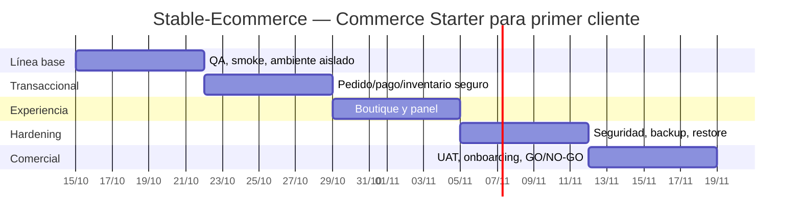

# Stable-Ecommerce / Commerce Starter — Roadmap MVP comercial auditado contra código

**Corte:** 14 de octubre de 2026 · **Repositorio:** `risejoaquin/stable-ecomerce` · **Base examinada:** `main@b164c8e4f3b8da8ce72b3590eae55b33c33c4d16` · **Estado comercial del paquete reproducible:** NO-GO hasta UAT de cliente y validación de release.

**Meta vendible V1:** Paquete Comercio Digital Inicial para una tienda, boutique o comercio mexicano: página y marca del negocio, catálogo con categorías/precios/fotos/variantes, carrito, pedido online, pago efectivo/transferencia cuando corresponda y trazabilidad manual de confirmación, contacto WhatsApp, panel administrativo, estados, promociones básicas, configuración, hosting y capacitación. **POS y automatización de redes sociales quedan fuera del alcance inicial.** No prometer un checkout por transferencia ya terminado basándose en el flujo Stripe que existe.

> Evidencia tomada de los archivos del repositorio, PR abiertos y GitHub Actions; esta auditoría es focalizada, no revisión línea por línea de 849 archivos. Cada capacidad debe cerrarse por prueba en el SHA candidato. El reporte histórico de producción de septiembre **no** prueba el nuevo paquete multi-cliente de octubre. No hacer merge ni despliegue de producción sin autorización separada.

## 1. Estado encontrado: código frente a funcionalidad comercial

| Dominio | Código inspeccionado | Clasificación actual | Brecha objetiva para vender un paquete repetible |
|---|---|---|---|
| Storefront y catálogo | `src/pages/store/HomePage.tsx`, `src/pages/store/ProductDetailPage.tsx`, `src/hooks/useStoreConfig.ts` | Implementación presente; no UAT nuevo negocio | Ver catálogo real con variantes, disponibilidad, producto agotado, fotos, configuración por comercio y responsive |
| Carrito y checkout | `src/App.tsx`, `src/hooks/useCheckout.ts` | Implementación presente; checkout actual crea `/orders` y solicita `/checkout` con URL externa | Confirmar pago aprobado solo por fuente autorizada, transferencia/efectivo como canales de pedido **sin falsificar cobro**, manejo de duplicados, fallos y pendientes |
| Panel y gestión de pedidos | `src/hooks/useAdminOrders.ts`, `src/pages/admin/AdminOrdersPage.tsx` | Rutas/UI de listado, detalle, estado, tracking, reembolso y notificaciones existentes | Probar RBAC de un negocio cliente, transiciones válidas, edición limitada, status correcto y exportación |
| Seguridad de API | `src/server/middleware/auth.ts`, `server.ts`, `tests/api/functional-quality-contracts.test.ts`, `tests/security/critical-functions-security.test.ts` | Código y algunas pruebas presentes | Auditoría tenant/store, JWT, webhook, cargas, PII; demostrar fail-closed y 0 cross-tenant |
| Inventario SellableUnit | `src/services/inventory-service`, `tests/unit/inventory/sellable-unit.test.ts`, PR #34 | Contratos/modelos y tests presentes; integración pendiente de revisar | Vender stock real sin oversell, migración aditiva comprobada; no aplicar PR #34 indiscriminadamente |
| Ledger pagos/pedido | PR #35, `src/hooks/useCheckout.ts`, backend `server.ts` | Solución distribuida entre main y PR; necesita conciliación | Estados de pago, idempotencia, webhook verificado, reembolso/manual transfer correctamente separado |
| Calidad/CI | `.github/workflows/quality-gate.yml`, scripts `scripts/qa/validate-fast.ps1` y `validate-release.ps1` | Quality Gate PASS consultado en main | **Production Smoke FALLÓ dos veces** en runs del 10-oct; investigar causa antes de certificar operación actual |
| Despliegue y operación | `docs/engineering/operations/PRODUCTION_RELEASE_RUNBOOK.md`, `.github/workflows/production-smoke.yml` | Documentación y despliegue histórico existentes | El rollout de otro cliente requiere staging aislado, migración, rollback, logs, DNS/SSL y soporte con su propio UAT |

**Observación sobre negocio:** existen frontend React, API Express, Stripe, Supabase y Resend; no equivalen a una instalación reproducible, genérica y vendible para una boutique sin cambios de alcance. Historial: `artifacts/pl20-final-closure/readiness-final.md` (22-sep) registró readiness técnico de Selfcare Sinners en otro SHA. Al 14-oct, el Quality Gate de main fue exitoso, pero el workflow **Selfcare Production Smoke** más reciente observado falló el 10-oct. Investigar el motivo; no extrapolar el cierre histórico.

**Gobernanza:** los contratos `DR-INV-001`, `DR-PAY-001`, `DR-IDEM-001`, `DR-AUTH-001`, `DR-ERR-001` y `DR-REC-001` están congelados para Client01; una corrección debe respetarlos. PR #34 (SellableUnit), #35 (payment ledger), #36 (Meta legal) y #33 (CODEOWNER) requieren análisis independiente; **Meta/WEB POS no son obligatorios del Commerce Starter**. Preservar separación de revisiones y CI de `main`; los plazos Client01 del 3–5 de octubre están vencidos y no son fechas de release aprobadas.

## 2. Contrato de MVP comercial y pruebas obligatorias

| ID | Condición de aceptación demostrable |
|---|---|
| EC-ACC-01 | Una nueva tienda puede configurarse en staging independiente sin editar manualmente el código de la tienda anterior; dominio, branding y catálogo correctos |
| EC-ACC-02 | Home/categorías/búsqueda/detalle/carrito se usan en móvil; talla, color, stock y precio del SKU pasan iguales al checkout |
| EC-ACC-03 | Pedido con cliente y dirección, entrega/recolección según acuerdo, persistencia y folio; errores no generan pedidos huérfanos |
| EC-ACC-04 | Efectivo/transferencia **no se presentan como liquidados** hasta conciliación manual del negocio; Stripe/mercado proveedor solo si se habilita y valida oficialmente |
| EC-ACC-05 | Repetición de solicitud, webhook duplicado, reconexión y cancelación no duplican cobro, pedido, inventario ni correo; 0 oversell |
| EC-ACC-06 | Administrador de tienda gestiona pedidos, estados, productos, promociones y contacto; usuario de otro tenant no puede leer/editar nada |
| EC-ACC-07 | Mail/WhatsApp de notificación funcionan como canales de comunicación, sin acoplar error del correo al commit de la venta; no prometer bot WA |
| EC-ACC-08 | Seguridad QA (login, privilegio mínimo, cargas, PII, secretos, tarifas/precios de servidor) y accesibilidad/SEO/móvil superan umbral definido en release |
| EC-ACC-09 | Test E2E de pago exitoso, rechazado, pendiente, retorno y devolución si está incluida; evidencias de transacciones y webhooks |
| EC-ACC-10 | Staging reproducible, smoke PASS, backup+restore, rollback ensayado, CI completo, manual de soporte y capacitación; 0 P0/P1 |
| EC-ACC-11 | Cliente firma alcance y UAT de tienda operativa; oferta (setup + hosting + soporte) rentable, autorización expresa PO GO/NO-GO |

No agregar POS, CRM avanzado, social automation ni multi-sucursal como requisitos por defecto. Si el cliente exige Mercado Pago, Stripe, CFDI o envío real, cotizar extensión con su propio diseño y pruebas, no suponerla entregada.

## 3. Backlog priorizado de ingeniería y aceptación

| ID | P | Alcance concreto | Gate / prueba | Dependencias |
|---|---|---|---|---|
| EC-01 | P0 | Ejecutar baseline CI y diagnosticar `production-smoke` fallido; inventariar rutas, claves/ambientes y PR con relevancia al MVP | Quality Gate + smoke PASS o reporte causal reproducible; SHA registrado | — |
| EC-02 | P0 | Definir configuración reutilizable de un segundo negocio en staging aislado: marca, tienda, catálogo, host, credenciales | Dos tiendas aisladas en ambientes de prueba, sin copia de secretos ni cross-tenant | EC-01 |
| EC-03 | P0 | Hardening de flujo pedido/pago: precios sólo servidor, transacciones, inventario SKU, idempotencia, estados transfer/cash pendientes, webhooks | E2E pedido y reconciliación 0 doble efecto; decisiones sobre PR #34/#35 documentadas | EC-01/02 |
| EC-04 | P1 | Adaptación Commerce Starter a boutique: categorías, tallas, colores, imágenes, stock y checkout móvil | Playwright mobile + pruebas de stock/variante/precio, UX con datos reales ficticios | EC-02/03 |
| EC-05 | P1 | Admin de comerciante: pedidos, estados, perfiles, notas, email/WhatsApp, promociones, operaciones permitidas | Actor owner/operator/shopper y bloqueos tenant; lista de pedidos y auditoría | EC-03 |
| EC-06 | P0 | Seguridad: firmas proveedores, uploads, RBAC, secretos, cookies, CSP, privacidad y revisión de PR relevantes | Negativas/abuso PASS; SAST/deps revisadas; 0 P0/P1 | EC-01..05 |
| EC-07 | P0 | Paquete comercial repetible: onboarding, contrato, DNS/SSL, respaldo/restauración, rollback, manual soporte y capacitación | Staging segundo cliente listo y restaurado en ensayo, plan de contingencia firmado | EC-02..06 |
| EC-08 | P0 | UAT con dueño boutique/comercio piloto, evidencia y aceptación, presupuesto de infraestructura, cotización y cierre primer cliente | EC-ACC 01..11, 0 P0/P1, revisión independiente y PO GO/NO-GO | EC-03..07 |
| EC-09 | P2 | Fase SaaS/white-label: billing recurrente, autoservicio, plantillas multi-tenant, analítica, límites de plan | Solo después de cliente pagador; roadmap y gates separados | EC-08 |

**Ruta crítica:** EC-01 → EC-02 → EC-03 → EC-06 → EC-07 → EC-08. EC-04/05 avanzan en paralelo solo después de fijar contratos. **No** fusionar PR #34/#35 solo porque existen: inspeccionar migraciones, permisos, contratos y test del mismo SHA; corrección del modelo de respuesta prevalece sobre adaptaciones cliente.

## 4. Calendario y Gantt del MVP (5 semanas)

| Semana | Fechas | Resultado esperado | Criterio de avance |
|---|---|---|---|
| W1 | 15–21 oct | EC-01/02: diagnóstico CI/smoke, definición de oferta y ambiente segundo comercio | smoke diagnosticado + aislamiento probado |
| W2 | 22–28 oct | EC-03: pedidos, ledger/canal manual y stock correcto | casos de doble pedido/oversell/webhook en CI |
| W3 | 29 oct–4 nov | EC-04/05: boutique móvil, catálogo, panel cliente y admin | E2E actor por actor y UAT interno |
| W4 | 5–11 nov | EC-06/07: seguridad, staging, restauración y runbooks | QA release y fail/rollback PASS |
| W5 | 12–18 nov | EC-08: revisión cliente piloto, onboarding, capacitación y aceptación comercial | EC-ACC 01..11 y autorización PO |

Las fechas son objetivos condicionados a integración y cliente disponible; no equivalen a fechas de producción. Railway se usa solo con autorización, y la fase de desarrollo permanece local/CI y staging de pruebas según decisiones previas.

## 5. Matriz de riesgos

| Riesgo | Prob. / impacto | Mitigación / responsable |
|---|---|---|
| Production Smoke falla, pero docs históricas dicen READY | Alta/Crítica | Diagnóstico por run/sha; detener comercial GO hasta smoke válido; QA |
| Modelo de pagos inconsistente (cash/transfer vs Stripe) | Alta/Crítica | Estados diferenciados, conciliación manual y tests; ingeniería |
| Concurrencia causa oversell de talla/color | Alta/Crítica | SellableUnit, locks/atomicidad, 50 compras simultáneas en staging; backend |
| Cambiar contrato congelado para adaptar frontend | Media/Crítica | Corregir fuente/contrato, ADR si conflicto; arquitectura |
| PR #34/#35 con migraciones no auditadas | Alta/Crítica | migración aditiva, backfill, plan rollback y verificación SQL; DB owner |
| Cruce de datos entre tiendas | Media/Crítica | RLS/test tenant/rol y datos ficticios; seguridad |
| Plantilla visual atada a Selfcare Sinners | Alta/Alta | parametrizar marca, navegación y páginas, segunda tienda test; frontend |
| Datos de producción expuestos durante pruebas | Media/Crítica | staging desechable sin PII, credenciales de prueba; operaciones |
| Sobreingeniería de POS, redes/CRM antes de venta | Alta/Alta | paquete fijo y control de cambios/cotización add-on; PO |
| Costos de soporte / hosting no cubiertos por precio | Media/Alta | presupuesto operativo y precios setup/mantenimiento; comercial |
| Autorización de merge/deploy implícita | Media/Crítica | revisión cruzada, GitHub branch protection y PO GO; gobernanza |

## 6. Estrategia de primera venta y transición SaaS

**Paquete inicial:** web de la marca, catálogo y variante, carrito, pedido online, información de cliente, pago/confirmación por efectivo o transferencia cuando aplique, enlace WhatsApp, panel de pedidos, estados, promociones, hosting inicial y capacitación. **No:** POS, Meta automations, IA de atención, ERP completo o rediseño del sistema de inventario sin necesidad.

**Venta:** entrevistar primero negocios que **ya solicitan** el servicio; levantar 10 requisitos exactos y materiales, mostrar demo de su catálogo, propuesta con setup+cuota mantenimiento/hosting, anticipo y UAT firmada. No prometer funciones basándose en archivos JSX no probados. Registrar margen bruto del setup y costo mensual real.

**SaaS después:** despliegues repetibles, tenants y marcas aislados, onboarding self-service, pagos recurrentes, operación multitienda, soporte y límites por plan; financiar con casos de uso validados, no con supuestos.

**KPIs de aceptación:** 0 sobreventas/doble cobro, pedidos de prueba conciliados, pruebas actor por rol, smoke y restore PASS, 0 P0/P1, dueño capacitado y orden de servicio aceptada. Avance: N/D hasta inventariar matriz ponderada específica EC-ACC; no extrapolar porcentajes de SolidPOS ni medir commits.

## 7. Reglas de ejecución para automatizaciones

Antes de cada iteración leer `AGENTS.md`, contratos `DR-*`, CI/PR recientes y este archivo. Elegir máximo un ID EC-01..08 con dependencias libres; revisar código y test previo; trabajar en **branch de feature**, producir una prueba nueva, ejecutar `npm run lint`, `npm test`, `npm run build`, Playwright relevante y `scripts/qa/validate-fast.ps1`/`validate-release.ps1` según alcance. Adjuntar `ID → archivos → commit → SHA → CI → evidencia → revisor`; fail != PASS. No autoaprobar PR, merge, tocar Railway/Supabase o cambiar secretos. Si existe bloqueo externo, registrar acción humana y seguir una tarea independiente.

**Estado:** roadmap de tareas completo y anclado a código revisado; MVP comercial **NO-GO** hasta EC-08 y autorización expresa.
